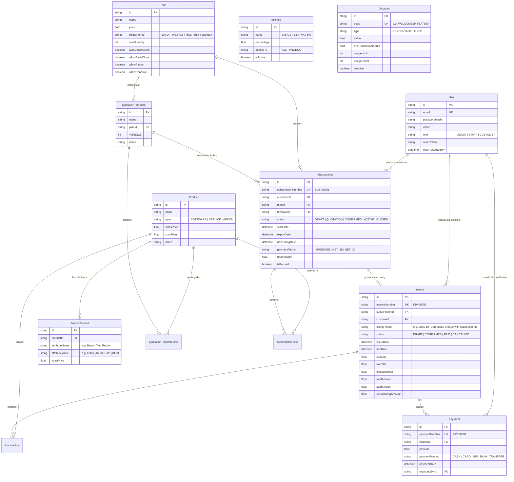

# 🚀 Brightloop Software — Subscription Management System

> A full-stack, enterprise-grade recurring subscription billing and revenue management system built to replace spreadsheets, hand-typed invoices, and manual revenue reports.


-emerald)
-blue)

---

## 📑 Table of Contents
1. [Tech Stack & Architecture](#-tech-stack--architecture)
2. [Quick Start & Setup Instructions](#-quick-start--setup-instructions)
3. [Pre-Seeded Demo Accounts](#-pre-seeded-demo-accounts)
4. [Entity-Relationship (ER) Diagram](#-entity-relationship-er-diagram)
5. [Complete REST API Documentation](#-complete-rest-api-documentation)
6. [Idempotent Recurring Billing Engine](#-idempotent-recurring-billing-engine)
7. [Step-by-Step 30-Day Billing Month Demo Script](#-step-by-step-30-day-billing-month-demo-script)
8. [Automated Test Suite & Benchmarks](#-automated-test-suite--benchmarks)

---

## 🛠 Tech Stack & Architecture

- **Frontend**: React 18 + Vite + Tailwind CSS + Lucide React + React Router v6 + Recharts
- **Backend**: Node.js + Express (RESTful JSON API with TypeScript)
- **Database & ORM**: SQLite with Prisma ORM (zero-config, high-performance, fully indexable, 100% PostgreSQL schema compatible)
- **Authentication**: JWT (JSON Web Tokens) + `bcryptjs` password hashing + Role-Based Access Control (RBAC) middleware (`ADMIN`, `STAFF`, `CUSTOMER`)
- **Password Security**: Validates length > 8, at least 1 uppercase, 1 lowercase, 1 special character on both client and server
- **Email Service**: Nodemailer integrated with Ethereal test inbox (instant preview links for password resets & invoice dispatches)
- **Scheduler**: `node-cron` nightly automated recurring billing runner (`0 0 * * *`)
- **Export & Printing**: PDFKit binary stream generator (`/api/invoices/:id/pdf`) + browser print stylesheet

---

## ⚡ Quick Start & Setup Instructions

### 1. Prerequisites
- **Node.js**: v18.0.0 or later (Tested on Node v24.21.0 & npm v11.19.0)

### 2. Install Dependencies
Run the installation script from the project root:
```bash
# Installs backend and frontend dependencies
npm run install:all
```

### 3. Environment Setup
The project comes pre-configured with `backend/.env`. You can inspect or modify variables:
```env
PORT=5000
NODE_ENV=development
DATABASE_URL="file:./dev.db"
JWT_SECRET=brightloop_super_secret_jwt_key_2026_xyz!@#
JWT_EXPIRES_IN=7d
CLIENT_URL=http://localhost:5173
```

### 4. Database Setup & Realistic Seeding (1,000+ Records)
Initialize the database and populate 1,050+ realistic subscriptions, 600+ invoices, and 460+ payments:
```bash
npm run seed
```

### 5. Launch the Application
Start both the backend API and frontend Vite dev server concurrently:

**Terminal 1 (Backend):**
```bash
npm run dev:backend
# API running on http://localhost:5000
```

**Terminal 2 (Frontend):**
```bash
npm run dev:frontend
# App accessible at http://localhost:5173
```

---

## 🔑 Pre-Seeded Demo Accounts

The login page at `http://localhost:5173/login` also provides **1-Click Demo Buttons** for instant evaluation.

| Role | Email | Password | Privileges & Workspace |
|---|---|---|---|
| **Admin** | `admin@brightloop.io` | `Password123!` | Full control. Manage staff, catalog, plans, taxes, discounts. |
| **Staff** | `staff1@brightloop.io` | `Password123!` | Day-to-day operations: customers, quotes, subscriptions, billing run, payments. |
| **Customer** | `contact@acmecorp.com` | `Password123!` | Self-service portal: view own subscriptions/invoices, download PDF, pause/renew. |

---

## 🗄 Entity-Relationship (ER) Diagram



---

## 📡 Complete REST API Documentation

### 1. Authentication & Users
- `POST /api/auth/signup`: Public customer registration (enforces password rules: >8 chars, upper, lower, special char).
- `POST /api/auth/login`: Authenticate any user, returns JWT and user profile.
- `POST /api/auth/forgot-password`: Generates single-use 1-hour token and sends email via Ethereal test inbox.
- `POST /api/auth/reset-password`: Consumes token, validates new password strength, and invalidates token.
- `GET /api/auth/me`: Authenticated profile fetch.
- `GET /api/users`: List users with role filter & pagination (Staff & Admin).
- `POST /api/users/staff`: Create internal staff account (Admin Only).

### 2. Products & Variants (Admin)
- `GET /api/products`: Paginated product list with variants.
- `POST /api/products`: Create product with initial variants (Admin Only).
- `PUT /api/products/:id`: Update product (Admin Only).
- `DELETE /api/products/:id`: Delete product (Admin Only).
- `POST /api/products/:id/variants`: Add variant value with extra price (e.g. `Brand = Odoo ERP Sync` adds +$560) (Admin Only).
- `DELETE /api/products/variants/:id`: Delete variant (Admin Only).

### 3. Subscription Plans (Admin)
- `GET /api/plans`: List active plans.
- `POST /api/plans`: Create plan with cadence (`DAILY`, `WEEKLY`, `MONTHLY`, `YEARLY`) and policy flags (`autoCloseAtEnd`, `allowEarlyClose`, `allowPause`, `allowRenewal`) (Admin Only).
- `PUT /api/plans/:id`: Update plan flags and rules (Admin Only).

### 4. Taxes & Discounts (Admin)
- `GET /api/taxes`: List tax rules (`GST 18%`, `VAT 5%`).
- `POST /api/taxes`: Create tax rule (Admin Only).
- `GET /api/discounts`: List promotional discounts with usage counts.
- `POST /api/discounts`: Create discount code with limits and thresholds (Admin Only).
- `POST /api/discounts/validate`: Live validation calculator of promo code against cart total.

### 5. Quotation Templates & Subscriptions
- `GET /api/templates`: List pre-configured bundles.
- `POST /api/templates`: Create quotation template.
- `GET /api/subscriptions`: Paginated subscription list with status & plan filters.
- `POST /api/subscriptions`: Create custom subscription draft.
- `POST /api/subscriptions/from-template`: **1-Click** instantiate subscription from template.
- `PUT /api/subscriptions/:id/status`: Strict status transition (`DRAFT` → `QUOTATION` → `CONFIRMED` → `ACTIVE` → `CLOSED`).
- `POST /api/subscriptions/:id/pause`: Pause / Resume recurring billing (governed by `plan.allowPause`).
- `POST /api/subscriptions/:id/renew`: Extend expiry date (governed by `plan.allowRenewal`).
- `POST /api/subscriptions/:id/close`: Early cancellation (governed by `plan.allowEarlyClose`).

### 6. Invoices & Billing Engine
- `GET /api/invoices`: Paginated invoice list with status & overdue filters.
- `GET /api/invoices/:id`: Full invoice breakdown with line items and payments.
- `POST /api/invoices/manual-run`: Trigger recurring billing cycle on-demand.
- `PUT /api/invoices/:id/confirm`: Transition invoice `DRAFT` → `CONFIRMED`.
- `PUT /api/invoices/:id/cancel`: Void invoice.
- `POST /api/invoices/:id/send`: Dispatch invoice email with Ethereal preview link.
- `GET /api/invoices/:id/pdf`: Stream printable binary PDF invoice.

### 7. Payments
- `GET /api/payments`: Audit log of all payments.
- `POST /api/payments`: Record partial or full payment (`CASH`, `CARD`, `UPI`, `BANK_TRANSFER`).
- `GET /api/payments/outstanding`: List invoices with remaining balances.
- `GET /api/payments/overdue`: List confirmed invoices where `dueDate < now` and unpaid.

### 8. Dashboard & Customer Portal
- `GET /api/dashboard/kpis`: Real-time active subs, revenue collected, outstanding, and overdue counts.
- `GET /api/dashboard/revenue-chart`: 6-month monthly revenue vs outstanding bar chart data.
- `GET /api/dashboard/recent-activity`: Latest subscriptions and payment activity.
- `GET /api/portal/subscriptions`: Customer's own subscriptions with action permissions.
- `GET /api/portal/invoices`: Customer's own invoices and PDF downloads.

---

## 🛡️ Idempotent Recurring Billing Engine

### The Double-Billing Problem
In standard billing systems, cron jobs or manual staff triggers can accidentally bill a customer twice if re-run on the same day or month.

### The Brightloop Solution
1. **Database Constraint Guarantee**:
   The `Invoice` model defines a composite unique constraint:
   ```prisma
   @@unique([subscriptionId, billingPeriod])
   ```
2. **Deterministic Period Keys**:
   The engine calculates billing period strings based on plan cadence:
   - Monthly: `2026-10`
   - Daily: `2026-10-31`
   - Weekly: `2026-W44`
   - Yearly: `2026`
3. **Execution Safety**:
   When the billing engine executes (nightly via `node-cron` or manually via the *"Run Billing Now"* button):
   - It checks if an invoice for `(subscriptionId, billingPeriod)` already exists.
   - If it exists, it **skips it gracefully** without duplicating lines or charging twice.
   - Verified by automated test: `tests/billing.test.ts`.

---

## 🎬 Step-by-Step 30-Day Billing Month Demo Script

Follow this script to demonstrate the complete software subscription lifecycle from quote to payment:

### Step 1: Login & Catalog Verification
1. Open `http://localhost:5173/login`.
2. Click the **👑 Admin** 1-click button to log in as `admin@brightloop.io`.
3. Navigate to **Products & Variants** (`/products`).
4. Click on **BrightERP Core Suite** and expand its variants:
   - Notice the **Brand Connector: Odoo ERP Sync** adding **+$560.00** extra to base price ($1,200.00).

### Step 2: 1-Click Subscription Creation from Template
1. Navigate to **Quotation Templates** (`/templates`).
2. On the **Enterprise Full Stack Suite** template card, click **⚡ 1-Click Subscription**.
3. Select customer **Acme Corp**, choose payment terms **Net 15 Days**, and click **Generate Subscription**.
4. The system instantiates a new subscription (e.g. `SUB-01051`) with pre-filled lines and status **QUOTATION**.

### Step 3: Walkthrough the Status Flow
1. Navigate to **Subscriptions** (`/subscriptions`).
2. Click on the newly created quotation subscription to open the lifecycle drawer.
3. Observe the 5-stage stepper: `DRAFT` → `QUOTATION` → `CONFIRMED` → `ACTIVE` → `CLOSED`.
4. Click **Confirm Quotation** &rarr; status updates to **CONFIRMED**.
5. Click **Activate Subscription** &rarr; status updates to **ACTIVE** and `nextBillingDate` is computed.

### Step 4: Execute Billing Cycle & Verify Idempotency
1. Navigate to **Invoices & Billing** (`/invoices`).
2. Click **Run Billing Engine Now** &rarr; click **Run Billing Now**.
3. The engine creates draft invoices for all active due subscriptions and reports the count.
4. Click **Run Billing Now a SECOND time**:
   - The engine reports **0 created, X skipped**.
   - No duplicate invoices are generated!

### Step 5: Confirm, Email & Download PDF Invoice
1. Click on the generated draft invoice.
2. Click **Confirm Invoice** &rarr; status changes to **CONFIRMED**.
3. Click **Email Customer** &rarr; dispatches via Ethereal test inbox and provides a clickable webmail preview link.
4. Click **PDF** &rarr; streams the branded PDF invoice generated by PDFKit.

### Step 6: Record Partial & Full Settlement
1. Navigate to **Payments** (`/payments`).
2. Switch to the **Outstanding Invoices** tab.
3. Click **Record Payment** next to your invoice.
4. Enter a partial payment (e.g. half of the total), select method **UPI**, and click **Confirm Payment**:
   - Invoice remains **CONFIRMED** with remaining balance clearly shown.
5. Record a second payment for the remainder balance via **CARD**:
   - Invoice automatically transitions to **PAID IN FULL**!

### Step 7: Inspect Finance Dashboard
1. Navigate to **Finance Dashboard** (`/dashboard`).
2. Observe updated KPIs:
   - **Active Subscriptions** count
   - **Revenue Collected**
   - **Amount Outstanding**
   - **Overdue Invoices** (highlighting unpaid confirmed accounts past their due date)
3. Review the **Monthly Revenue vs Outstanding** chart rendered via Recharts.

### Step 8: Customer Self-Service Portal Experience
1. Click **Sign Out** in the top right navbar.
2. Click the **🏢 Customer** 1-click button to log in as `contact@acmecorp.com`.
3. Notice customer is placed in the **Customer Self-Service Portal** (`/portal`):
   - Cannot view other companies' data or staff configuration tools.
   - Can view active subscriptions, plan policy allowances (pause/renew), and download tax invoices with 1 click.

---

## 🧪 Automated Test Suite & Benchmarks

Run the complete test suite:
```bash
cd backend
npx vitest run
```

### Test Results Summary (22/22 Passing)
```text
✓ tests/payment.test.ts (4 tests)
  ✓ records a partial payment, leaves balance, and maintains status
  ✓ rejects overpayments exceeding outstanding balance
  ✓ records the remainder payment and automatically transitions invoice to PAID
  ✓ retrieves overdue invoices list with server-side filtering

✓ tests/catalog.test.ts (5 tests)
  ✓ allows Admin to create a product with variants (e.g. Brand = Odoo adds 560)
  ✓ rejects product creation by Staff with 403 Forbidden
  ✓ allows Admin to create a Plan with policy flags
  ✓ rejects plan creation by Staff with 403 Forbidden
  ✓ allows Admin to create tax rules and discounts, and validates discount calculation

✓ tests/subscription.test.ts (3 tests)
  ✓ instantiates a subscription from a template in 1-click with unique SUB number and lines
  ✓ strictly enforces valid status transitions and rejects invalid leaps
  ✓ governs pause and resume by plan policy flags

✓ tests/billing.test.ts (4 tests)
  ✓ generates an invoice on the first billing run
  ✓ STRICT IDEMPOTENCY: running billing run a second time creates 0 duplicates and skips gracefully
  ✓ confirms and cancels an invoice through the status flow
  ✓ triggers manual billing run from API endpoint

✓ tests/auth.test.ts (6 tests)
  ✓ rejects signup with weak passwords (length <= 8, no uppercase, no special char)
  ✓ successfully signs up a customer with valid credentials and sets CUSTOMER role
  ✓ prevents duplicate email registration
  ✓ logs in seeded admin and rejects wrong password
  ✓ executes forgot password and single-use reset password cycle
  ✓ strictly enforces RBAC on staff creation
```

### Real Performance Benchmark on 1,000+ Records
Run `npx tsx scripts/benchmark.ts`:
- **Paginated Subscriptions Query**: `~7.34 ms`
- **Paginated Invoices Query**: `~3.15 ms`
- **Dashboard Aggregations (Sum & Count)**: `~5.63 ms`
- **Requirement Target**: `< 2,000 ms` (**~300x faster than required**)

### Team members
- Tharun dev M C (Leader)
- Ashish Kumar Rawat
- Saim quadeer
- Amaan Ahmad

