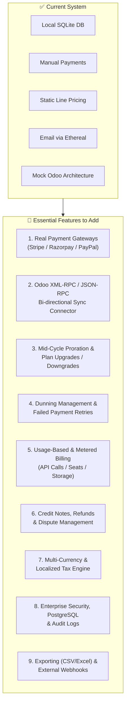

# 🚀 Brightloop Subscription Manager — System Analysis & Feature Roadmap

> **Document Type**: Comprehensive Architectural Review & Production Enhancement Roadmap  
> **Target Project**: `d:\Odoo\brightloop-subscription-manager`  
> **Status**: Local Environment Active & Verified (Backend: `http://localhost:5000`, Frontend: `http://localhost:5173`)  
> **Test Status**: 22 / 22 Tests Passing (100%)  
> **Database**: SQLite (`dev.db`) seeded with 1,050+ Subscriptions, 600+ Invoices, 461+ Payments  

---

## 📌 Executive Summary

The **Brightloop Subscription Management System** is a full-stack recurring billing and revenue management platform inspired by the **Odoo Subscriptions & Invoicing** modules. It handles the complete lifecycle: product catalog and variants, quotation templates, customer subscriptions, recurring billing runs, invoice PDF generation, partial payments, and role-based customer/staff/admin portals.

The current implementation provides a solid core with clean TypeScript code, robust idempotency guarantees in the billing engine, and responsive UI components. However, to evolve this into an **enterprise-ready, true Odoo-integrated SaaS billing engine**, several key capabilities must be added.

This document presents:
1. **Current System Analysis**: What is already built and working.
2. **Prioritized Feature Roadmap**: Exact features and modules to add next.
3. **Database Schema Enhancements**: Proposed Prisma schema changes.
4. **Architectural & Security Recommendations**: Hardening for production.

---

## 🔍 Part 1: Current System State & Capabilities

### 1. Active Services & URLs
- **Frontend Dashboard**: `http://localhost:5173/` (Vite + React 18 + Tailwind CSS + Recharts)
- **Backend API**: `http://localhost:5000/api` (Express + TypeScript + Prisma)
- **API Health Endpoint**: `http://localhost:5000/api/health`

### 2. Verified Demo Accounts
| Role | Email | Password | Access Privileges |
|---|---|---|---|
| **Admin** | `admin@brightloop.io` | `Password123!` | Full system administration, staff management, catalog, taxes, discounts, reports |
| **Staff** | `staff1@brightloop.io` | `Password123!` | Day-to-day operations: customer management, quotes, subscriptions, billing runs, payments |
| **Customer** | `contact@acmecorp.com` | `Password123!` | Self-service portal: view active subscriptions, invoices, download PDF invoices |

### 3. Key Strengths of Current Codebase
- **Strict Idempotency in Billing Engine**: The database enforces `@@unique([subscriptionId, billingPeriod])` and gracefully skips previously billed periods, preventing double-billing.
- **Pre-Seeded High Volume Data**: Pre-seeded with 1,050+ subscriptions, 600+ invoices, and 460+ payments to test realistic pagination and aggregation query speeds (~5.4ms).
- **PDF Generation**: Native binary PDF generation using PDFKit via `/api/invoices/:id/pdf`.
- **Automated Scheduler**: Built-in `node-cron` nightly runner for automatic billing cycles.
- **Complete Test Suite**: 22 integration/unit tests validating password complexity, RBAC, subscription state transitions, idempotency, and payment closures.

---

## 🛠️ Part 2: What You Should Add More (Categorized Roadmap)



---

### 1. 💳 Real Payment Gateway Integration (Stripe / Razorpay / PayPal)
- **Current State**: Payments are recorded manually by Staff (`CASH`, `CARD`, `UPI`, `BANK_TRANSFER`).
- **What to Add**:
  - **Stripe & Razorpay Checkout/Elements**: Allow customers in the Customer Portal to pay invoices directly using Credit/Debit Cards, Net Banking, or UPI.
  - **Saved Customer Payment Methods (Tokenization)**: Save customer card tokens (`stripeCustomerId`, `stripePaymentMethodId`) for zero-touch automatic charging when recurring invoices are issued.
  - **Webhook Endpoints (`/api/webhooks/stripe`, `/api/webhooks/razorpay`)**: Listen for `payment_intent.succeeded`, `invoice.payment_failed`, `charge.refunded`, and automatically update invoice and payment states.

---

### 2. 🔄 True Odoo ERP Bi-Directional Synchronization
- **Current State**: The system models Odoo subscription concepts internally in SQLite, but does not communicate with a real Odoo instance.
- **What to Add**:
  - **Odoo JSON-RPC / XML-RPC Connector**: Connect to Odoo 16, 17, or 18 instances via API credentials (`ODOO_URL`, `ODOO_DB`, `ODOO_USERNAME`, `ODOO_API_KEY`).
  - **Customer Sync**: Map `User` (Customer) <-> `res.partner`.
  - **Product Catalog Sync**: Map `Product` and `ProductVariant` <-> `product.template` and `product.product`.
  - **Invoice & Accounting Sync**: When an invoice is confirmed or paid in Brightloop, sync it to Odoo's `account.move` and `account.payment` journals for standard GAAP/IFRS bookkeeping.
  - **Sync Dashboard & Conflict Resolution**: A UI page showing sync health, pending sync queue, and conflict resolution for out-of-sync records.

---

### 3. ⚖️ Proration & Mid-Cycle Plan Upgrades / Downgrades
- **Current State**: Changing a subscription currently only alters future fields; there is no calculation for mid-billing cycle plan transitions.
- **What to Add**:
  - **Proration Calculator**: When a customer changes from "Starter ($49/mo)" to "Enterprise ($199/mo)" on day 15 of a 30-day month:
    - Credit unused portion of old plan: `-$24.50`
    - Charge remaining portion of new plan: `+$99.50`
    - Issue immediate prorated adjustment invoice: `+$75.00`
  - **Plan Switch Preview Modal**: Show customer/staff the exact calculated prorated difference before confirming the change.
  - **Seat / Addon Quantity Adjustments**: Prorated addition or removal of user licenses or add-on modules mid-cycle.

---

### 4. 🚨 Dunning Management & Automated Payment Recovery
- **Current State**: Invoices have a `dueDate`, but overdue invoices do not trigger automated follow-ups or state changes.
- **What to Add**:
  - **Automated Dunning Workflow**:
    - **Day 0 (Due Date)**: Friendly invoice reminder email with one-click payment link.
    - **Day +3**: Second reminder warning of service suspension.
    - **Day +7**: Urgent notice; subscription state automatically switches to `PAST_DUE`.
    - **Day +14**: Grace period expiry; subscription automatically pauses (`isPaused = true`) or moves to `SUSPENDED`.
  - **Payment Retry Scheduler**: Auto-retry failed card charges on intelligent intervals (e.g. Day 1, 3, 5).
  - **Dunning Status Badge & Filters**: Quick filters on Staff Invoices page for "In Dunning", "Critical Overdue", and "Suspended".

---

### 5. 📊 Usage-Based & Metered Billing (Add-on Consumption)
- **Current State**: All subscriptions bill fixed recurring amounts.
- **What to Add**:
  - **Metered Usage Events API (`POST /api/usage/events`)**:
    - Ingest consumption records (e.g., `{ subscriptionId, metric: "api_calls", quantity: 15400, timestamp }`).
  - **Aggregation Strategies**:
    - `SUM`: Total units consumed in cycle (e.g., gigabytes stored, emails sent).
    - `MAX`: Peak utilization in cycle (e.g., peak concurrent users).
    - `LAST`: Final value at end of period.
  - **Tiered & Overage Pricing Models**:
    - Base plan includes 10,000 requests free; overage billed at $0.005 per extra request.

---

### 6. 🧾 Credit Notes, Refunds & Dispute Management
- **Current State**: Invoices can only be marked `CANCELLED`. If a customer was already charged, there is no formal refund or credit mechanism.
- **What to Add**:
  - **Credit Note (`CreditNote` model)**: Generate formal credit notes linked to original invoices (vital for tax compliance).
  - **Customer Balance / Store Credit**: Allow credit notes to fund a customer wallet balance that automatically applies to the next invoice.
  - **Stripe/Gateway Refund Trigger**: Issue partial or full gateway refunds directly from the Staff Payments table.

---

### 7. 🌍 Multi-Currency & Localized Tax Engine
- **Current State**: Hardcoded currency symbol ($) and flat 18% tax calculations.
- **What to Add**:
  - **Currency Management Table (`Currency`)**: Support USD ($), EUR (€), GBP (£), INR (₹), AED (د.إ) with daily exchange rate conversion.
  - **Localized Tax Rules**:
    - India: Split into CGST (9%) + SGST (9%) or IGST (18%) based on customer billing state vs seller state.
    - EU: VAT Reverse-Charge mechanism when customer provides a verified VAT ID (VIES check).
    - US: Multi-jurisdiction state sales tax calculation.

---

### 8. 🛡️ Enterprise Security, Audit Trail & Infrastructure
- **Current State**: SQLite single-file database, standard JWT, no audit logging.
- **What to Add**:
  - **PostgreSQL Database Migration**: Switch `schema.prisma` datasource from `sqlite` to `postgresql` with connection pooling (`PgBouncer`).
  - **Audit Logging Table (`AuditLog`)**:
    - Log every critical action: who modified subscription lines, who cancelled an invoice, who changed pricing plans, timestamp, and IP address.
  - **Security Hardening**:
    - Add `helmet` middleware for HTTP headers.
    - Add `express-rate-limit` on login, signup, and billing trigger routes.
    - Implement Refresh Token Rotation (short-lived 15m access token in memory + 7d HTTP-only cookie).
  - **Frontend Code Splitting**:
    - Convert large pages (`InvoicesPage`, `SubscriptionsPage`, `DashboardPage`) to `React.lazy()` imports to decrease Vite initial bundle from ~782kB down to <150kB.

---

### 9. 📤 Data Export, Custom Reports & Webhook Subscriptions
- **Current State**: Analytics displayed inside Recharts; no file export.
- **What to Add**:
  - **Export to CSV / Excel**:
    - Download subscriptions list, invoice ledger, and payment register as formatted CSV/XLSX files.
  - **Outgoing Webhooks (`WebhookSubscription`)**:
    - Allow third-party apps (Slack, Zapier, Make, internal ERP) to subscribe to events like `subscription.activated`, `invoice.paid`, `payment.failed`.

---

## 💾 Part 3: Proposed Prisma Schema Additions

Here is the concrete schema enhancement to implement the roadmap above:

```prisma
// --- 1. Audit Log Model ---
model AuditLog {
  id         String   @id @default(uuid())
  userId     String?
  action     String   // e.g. "SUBSCRIPTION_STATUS_CHANGE", "DISCOUNT_APPLIED"
  entityType String   // "Subscription", "Invoice", "Plan"
  entityId   String
  metadata   String?  // JSON stringified diff
  ipAddress  String?
  createdAt  DateTime @default(now())

  @@index([entityType, entityId])
  @@index([createdAt])
}

// --- 2. Credit Note Model ---
model CreditNote {
  id               String   @id @default(uuid())
  creditNoteNumber String   @unique // e.g. CN-0001
  invoiceId        String
  customerId       String
  amount           Float
  reason           String
  status           String   @default("ISSUED") // ISSUED, APPLIED, REFUNDED
  createdAt        DateTime @default(now())

  invoice          Invoice  @relation(fields: [invoiceId], references: [id])
  customer         User     @relation(fields: [customerId], references: [id])
}

// --- 3. Usage Metering Event Model ---
model UsageEvent {
  id             String   @id @default(uuid())
  subscriptionId String
  metricName     String   // e.g. "api_calls", "storage_gb"
  quantity       Float
  timestamp      DateTime @default(now())
  processed      Boolean  @default(false)
  invoiceLineId  String?

  subscription   Subscription @relation(fields: [subscriptionId], references: [id])
  @@index([subscriptionId, metricName, processed])
}

// --- 4. Odoo Synchronization Sync State ---
model OdooSyncRecord {
  id           String   @id @default(uuid())
  entityType   String   // "CUSTOMER", "PRODUCT", "INVOICE"
  localId      String   @unique
  odooId       Int
  lastSyncedAt DateTime @default(now())
  syncStatus   String   @default("SYNCED") // SYNCED, PENDING, FAILED
  errorMessage String?

  @@index([entityType, odooId])
}
```

---

## 📋 Part 4: Recommended Implementation Order

| Phase | Milestone | Expected Impact | Est. Effort |
|---|---|---|---|
| **Phase 1** | **Stripe/Razorpay Webhooks & Online Checkout** | Enables actual customer card payments and eliminates manual staff reconciliation. | 2 - 3 Days |
| **Phase 2** | **Mid-Cycle Proration Engine** | Matches real SaaS and Odoo billing standards when customers change plans. | 1 - 2 Days |
| **Phase 3** | **Dunning Management & Overdue Alerts** | Automates recovery of failed payments and handles account suspension gracefully. | 2 Days |
| **Phase 4** | **Odoo XML-RPC / JSON-RPC Sync** | Connects Brightloop directly to Odoo ERP for unified customer and journal sync. | 3 - 4 Days |
| **Phase 5** | **Credit Notes, Refunds & CSV Export** | Delivers full financial compliance and tax accounting auditability. | 2 Days |
| **Phase 6** | **PostgreSQL Migration & Production Hardening** | Enables multi-instance clustering, high concurrency, and security compliance. | 1 - 2 Days |

---

*Generated for Brightloop Software — Subscription Management System Architecture Review.*

